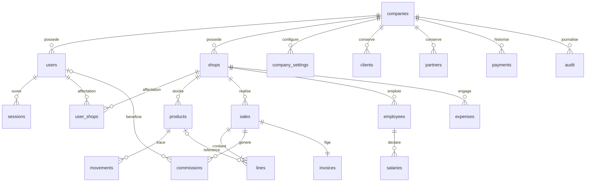

# Architecture

Client HTML/CSS/JavaScript sans compilation → API JSON Python → SQLite avec clés étrangères et transactions. `server.py` contient les routes et règles métier ; `documents.py` génère les PDF. Les fichiers statiques sont servis depuis une liste fermée de chemins.

## Isolation et accès

Chaque entité métier porte `company_id`. L’identité d’entreprise vient exclusivement de la session serveur. Les lectures sont filtrées et les références étrangères vérifiées dans le contexte de l’utilisateur avant mutation. `user_shops` restreint les boutiques hors propriétaire. Aucun hash de mot de passe ni jeton de session n’est renvoyé avec les listes. Sessions de 12 heures, jetons aléatoires, cookies HttpOnly/SameSite=Strict et CSRF pour les mutations. Les mots de passe utilisent PBKDF2-SHA256 avec sel indépendant.

Une transaction `BEGIN IMMEDIATE` couvre stock, lignes, commissions, paiement initial, instantané de facture et audit. La clé d’idempotence est unique par entreprise. Les mouvements et paiements sont conservés. Les lignes conservent prix et coût historiques. Le PDF utilise l’instantané de facture ; seul le statut et le total payé sont actualisés.

## Modèle relationnel

`payments` référence son objet par type et identifiant après contrôle de propriété dans l’API. Les catégories et types de partenaire sont des champs personnalisables dans cette version. Les clients d’une vente sont des désignations historiques libres, sans relation au fichier client : le rapprochement d’un historique client structuré reste à réaliser.

## API principale

Toutes les mutations utilisent POST JSON. En dehors de `register` et `login`, une session valide est obligatoire ; les POST requièrent `X-CSRF-Token` fourni par `GET /api/state`.

| Route | Usage |
|---|---|
| `POST /api/register`, `/api/login`, `/api/logout` | Comptes et sessions |
| `GET /api/state` | Données filtrées selon l’identité et le rôle |
| `POST /api/create`, `/api/update` | Référentiels autorisés, gestion des accès |
| `POST /api/sales` | Vente transactionnelle, clé `key`, lignes, bénéficiaires |
| `POST /api/cancel` | Annulation transactionnelle et stock |
| `POST /api/pay` | Règlement avec contrôle du solde |
| `POST /api/adjust` | Correction de stock motivée |
| `POST /api/import-preview`, `/api/import` | Lecture de fichier, puis intégration atomique |
| `POST /api/invoice`, `/api/invoice-pdf`, `/api/invoice-email` | Documents et envoi configuré |
| `POST /api/company-settings` | Mentions et logo |

## Évolution recommandée

Séparer domaine, persistence et transport lors de l’extension des modules. Pour un SaaS public à forte concurrence, migrer vers PostgreSQL et un serveur d’application adapté, ajouter pagination, contrôle de débit distribué, supervision, file de messagerie, migrations versionnées, tests de charge et contrôle de sécurité indépendant. Ces éléments ne sont pas simulés par la version locale.

## Internationalisation

Catalogue partagé `static/translations.json` pour interface et erreurs API, chargé avant le rendu. Les fragments HTML traduisent uniquement le texte de présentation et les attributs accessibles. Les données échappées utilisent des marqueurs opaques puis sont réinsérées après traduction ; elles ne passent pas dans le catalogue. Les valeurs canoniques des sélecteurs et les paramètres métier restent stables. Les documents PDF possèdent leurs libellés explicites et acceptent une langue indépendante, validée par le serveur.

## Couche SaaS et transport persistant

`saas.py` contient les formules, comptes entreprises, abonnements, règlements idempotents, quotas et journal éditeur. Un utilisateur `platform_admin` sans `company_id` accède uniquement à cette administration ; les rôles clients ne peuvent pas s’attribuer ce rôle. Les contrôles d’abonnement et de changement de mot de passe sont exécutés avant toute opération ERP. `wsgi.py` adapte le même gestionnaire métier à Gunicorn sans recopier les règles, avec validation de l’hôte et de l’origine si `PUBLIC_BASE_URL` est configuré. Les connexions SQLite sont fermées en sortie de contexte ; WAL, délais de verrouillage et quotas transactionnels limitent les conflits sur le serveur unique.
